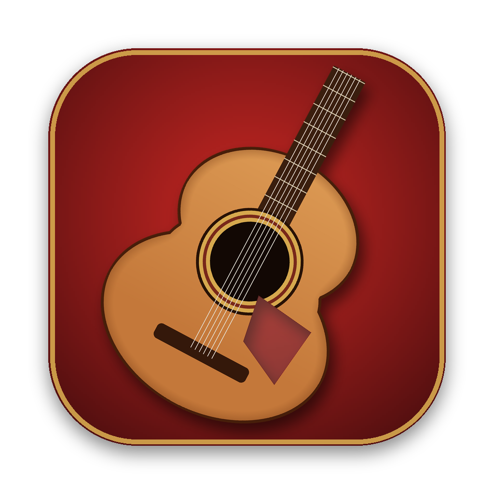

# Guitarra Flamenca

Convierte cualquier archivo **WAV** (piano, voz, acordes, una mezcla…) en **guitarra flamenca**
y lo exporta en **WAV** y **MIDI**. Funciona en **Windows** y **macOS**, en tu ordenador,
sin subir nada a Internet.

- Detecta todas las notas, también los acordes (polifónico).
- Las vuelve a tocar con muestras reales de guitarra flamenca (plugin gratuito
  *Flamenco Dreams Guitar V2*), con rasgueo y trémolo.
- Copia la dinámica y el timbre del original, y masteriza el resultado.
- **Preescucha en directo**: mientras mueves cualquier control, escuchas en bucle cómo quedará
  (≈1 s por cambio), y puedes compararlo con el original.
- **Reverb y ecualizador de la guitarra**, con estilos listos para usar:
  - Reverb: Seca, Estudio, Tablao, Patio andaluz, Sala de conciertos, Iglesia.
  - Ecualizador de 5 bandas: Plano, Flamenco nítido, Cálida, Con cuerpo, Brillante.
- **Ajuste recomendado**: la app analiza la onda del original, prueba los sonidos y ajustes del
  plugin y aplica el que más se le parece, explicando por qué. Luego puedes retocarlo.
- Escucha el resultado al momento, mézclalo con el original y guárdalo en la carpeta que elijas.

---

## Instalación (una sola vez)

### 1. Descarga la app
Pulsa el botón verde **Code → Download ZIP** de esta página y descomprímelo donde quieras
(por ejemplo en Documentos). O, si usas git: `git clone` de este repositorio.

### 2. Consigue el plugin de guitarra (gratis)
La app usa las muestras del instrumento **Flamenco Dreams Guitar V2** de *Martin Andrew Smith*
(formato Decent Sampler). No se incluye aquí porque pesa 1,3 GB y es obra de su autor.
Búscalo por su nombre, descárgalo y descomprímelo. Lo más cómodo es meter la carpeta
**Flamenco Dreams Guitar V2** dentro de la carpeta de la app (o en Documentos o Descargas):
la app la encuentra sola. Si no, al abrirla te pedirá que elijas la carpeta.

### 3. Instala y abre

**Windows**
1. Doble clic en **`instalar.bat`**.
   Si Windows avisa («Windows protegió su PC»), pulsa *Más información → Ejecutar de todas formas*.
2. Si no tienes Python 3.10, el instalador lo instala solo (con *winget*) o abre la página
   para descargarlo. En ese caso, marca **«Add python.exe to PATH»** al instalar y vuelve a
   abrir `instalar.bat`.
3. Tarda unos minutos. Al terminar crea el icono **Guitarra Flamenca** en el Escritorio
   y abre la app en el navegador.

**macOS**
1. Clic derecho en **`instalar.command`** → **Abrir** → **Abrir**.
   (Si macOS no deja abrirlo: *Ajustes del Sistema → Privacidad y seguridad → Abrir igualmente*.)
2. Si no tienes Python 3.10, lo instala con Homebrew o abre la página para descargarlo
   (elige el *macOS 64-bit universal2 installer*) y vuelve a abrir `instalar.command`.
3. Tarda unos minutos y abre la app en el navegador.

## Uso diario
| | Abrir | Cerrar |
|---|---|---|
| **Windows** | Icono **Guitarra Flamenca** del Escritorio (o `Iniciar Guitarra Flamenca.bat`) | Cierra la ventana negra minimizada, o `Parar Guitarra Flamenca.bat` |
| **macOS** | **Guitarra Flamenca.app** (o `Iniciar Guitarra Flamenca.command`) | `Parar Guitarra Flamenca.command` |

La app se abre en el navegador en `http://127.0.0.1:8850` (o el siguiente puerto libre hasta el 8859).

1. Sube tu WAV. Abajo aparece la **preescucha en directo**: pulsa ▶ y suena en bucle un fragmento
   ya convertido. Usa *Guitarra / Original* para comparar y la barra para elegir otro fragmento.
2. Pulsa **✨ Ajuste recomendado**, o elige el sonido y ajusta los controles a mano.
   Cada cambio se oye al momento en la preescucha.
3. Convierte y mira la barra de progreso.
4. Escucha la guitarra, el MIDI y el original.
5. Mezcla pistas, por ejemplo guitarra más un poco del original.
6. Guarda el WAV, el MIDI o la mezcla en la carpeta que elijas.

## Requisitos
- Windows 10/11 o macOS 11 o posterior (Intel o Apple Silicon).
- **Python 3.10** (también vale 3.9 o 3.11). El instalador lo busca y, si falta, ayuda a instalarlo.
- Unos 1,5 GB libres (librerías + plugin) y conexión a Internet solo durante la instalación.

## Problemas frecuentes
- **«Falta el plugin de guitarra»**: pulsa *Elegir carpeta…* y selecciona la carpeta
  `Flamenco Dreams Guitar V2` (la que contiene `Flamenco Dreams Guitar V2.dspreset`).
- **Python 3.12 o 3.13**: la detección de notas aún no funciona con ellos. Instala 3.10;
  puede convivir con la versión que ya tengas.
- **Para reinstalar desde cero**: borra la carpeta `.venv` y vuelve a abrir el instalador.
- **Si algo falla**: en Windows el motivo aparece en la ventana de la app. En Mac está en `logs/server.log`.

---

## Cómo funciona
1. **Detección de notas** con [basic-pitch](https://github.com/spotify/basic-pitch) (Spotify), polifónica.
   - Antes se separa la percusión para que no cree notas falsas.
   - Después se limpian las notas falsas: re-ataques que no existen, armónicos fantasma y artefactos.
2. **Toque de guitarrista**: registro real de la guitarra, rasgueo de acordes (abajo/arriba)
   y trémolo flamenco en las notas largas.
3. **Síntesis** con los WAV del plugin (mapa `.dspreset`, round robin, velocidad).
   - **Afinación exacta**: cada nota suena en su traste, como en una guitarra real.
   - La app mide una vez la afinación real de cada muestra del plugin y corrige su pequeña desviación.
   - Si el original no está a 440 Hz, la guitarra sigue su afinación general.
   - Error medido: 0,3 cents.
4. **Análisis de la onda del original**: se copia su dinámica y parte de su timbre.
5. **Nitidez flamenca**:
   - EQ de fase lineal y realce del ataque.
   - Filtro y reverb del plugin.
   - Masterización: compresión suave y limitador a −1 dBFS.
6. Se mide el **parecido armónico** con el original y se muestra en la app.

### Reverb y ecualizador
- **Reverb** de sala por convolución:
  - reflexiones tempranas con anchura estéreo y una cola difusa;
  - controles de cantidad, tamaño (duración de la cola), calidez (cuánto se apagan los agudos) y pre-delay;
  - la cola no lleva graves, para que la guitarra no se embarre.
- **Ecualizador** de fase lineal, solo para la guitarra:
  - 5 bandas: graves 100 Hz, cuerpo 250 Hz, medios 1 kHz, presencia 3,5 kHz y aire 10 kHz;
  - ±12 dB por banda, con la curva dibujada en pantalla.

### Preescucha en directo
Al subir el archivo se hace una sola vez la parte lenta: separar la percusión y pasar el modelo
de notas. Después, cada cambio de control recalcula las notas y toca solo un fragmento de 10 s
con la misma cadena que la conversión final. El fragmento empieza un poco antes, para que entren
las notas que ya sonaban, y se ajusta a su volumen real dentro de la pieza. Comparado con el
archivo final, el fragmento queda así:

| Aspecto | Diferencia con el archivo final |
|---|---|
| Ritmo | 0 ms de desfase |
| Dinámica | correlación ≥ 0,97 |
| Volumen | ±2 dB |
| Timbre | ±1-3 dB |

La conversión final reutiliza ese análisis y tarda la mitad.

### Ajuste recomendado (`recomendar.py`)
1. **Mide el original**: cuánta percusión tiene, si las notas se sostienen (voz, cuerda) o se
   apagan (piano, pulsado), cuántos acordes hay, si los pasajes son rápidos, si hay notas fuera
   del registro de la guitarra, cuánto ambiente o reverb tiene y cuánto contraste de volumen.
2. **Prueba con el plugin**: toca fragmentos reales con los 4 sonidos y con varias
   sensibilidades, cantidades de timbre copiado y de dinámica copiada. Puntúa cada prueba contra
   el original por:
   - parecido armónico
   - parecido de dinámica
   - parecido de timbre
3. **Aplica la mejor combinación** con límites que mantienen el sonido de guitarra flamenca
   limpia (nitidez alta, timbre copiado como máximo 50 %). Muestra el antes y el después y el
   porqué de cada decisión.

### Sonidos
| Sonido | Origen en el plugin |
|---|---|
| Guitarra de Estudio (recomendada) | V2, grupo *StudioGuitar* |
| Guitarra de Escenario | V2, grupo *StageGuitar* |
| Estudio + Escenario | V2, los dos grupos |
| Flamenco Dreams V1 | V1, con reverb |

### Pruebas
- `pruebas/prueba_rapida.py` recorre la app de punta a punta: preescucha, ajuste recomendado,
  conversión, WAV, MIDI, mezcla y guardado. Usa una guitarra sintética, así que no necesita el plugin. Se ejecuta en Windows y Mac
  en cada cambio (GitHub Actions).
- `pruebas/banco.py` mide la fidelidad con audios de notas conocidas (necesita el plugin).
  Resultado medio:
  - notas correctas (F1): **0,93**
  - precisión: **0,91**
  - parecido armónico: **0,92**

### Archivos
| Archivo | Qué es |
|---|---|
| `server.py` | servidor web local (Flask) |
| `engine.py` | detección de notas y síntesis |
| `instrument.py` | lectura del plugin |
| `recomendar.py` | ajuste recomendado |
| `index.html` | la interfaz |
| `instalar.*`, `Iniciar…`, `Parar…` | instalar, abrir y cerrar (`.bat` en Windows, `.command` en Mac) |
| `make_icon.py` | dibuja el icono |

## Créditos
- Muestras de guitarra: *Flamenco Dreams Guitar* © Martin Andrew Smith (se descarga aparte).
- Detección de notas: *basic-pitch* © Spotify (licencia Apache 2.0).
